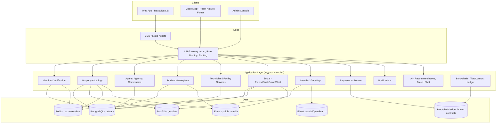
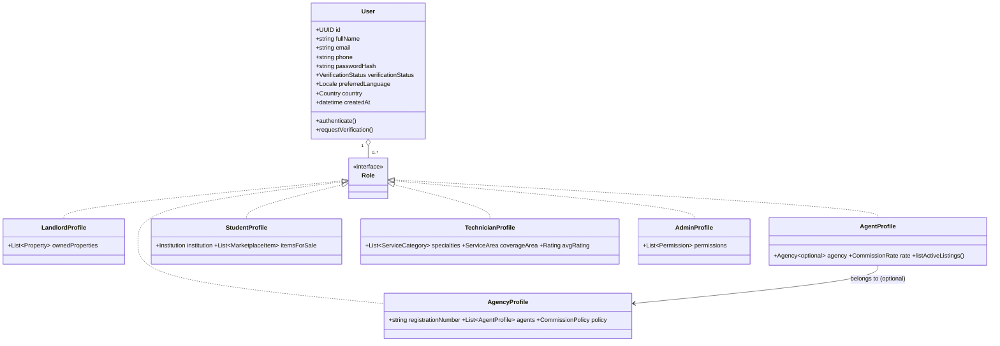
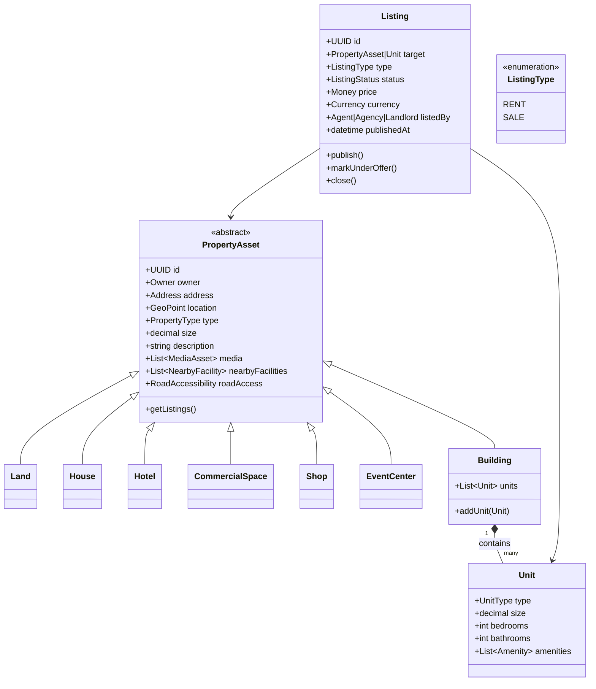
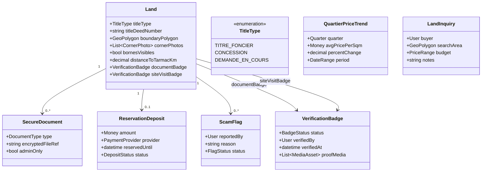
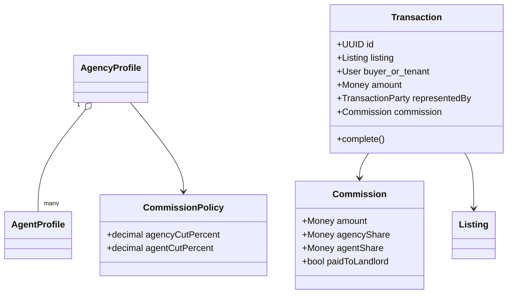
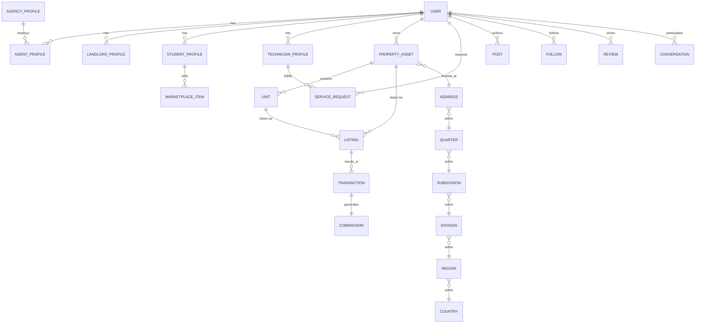
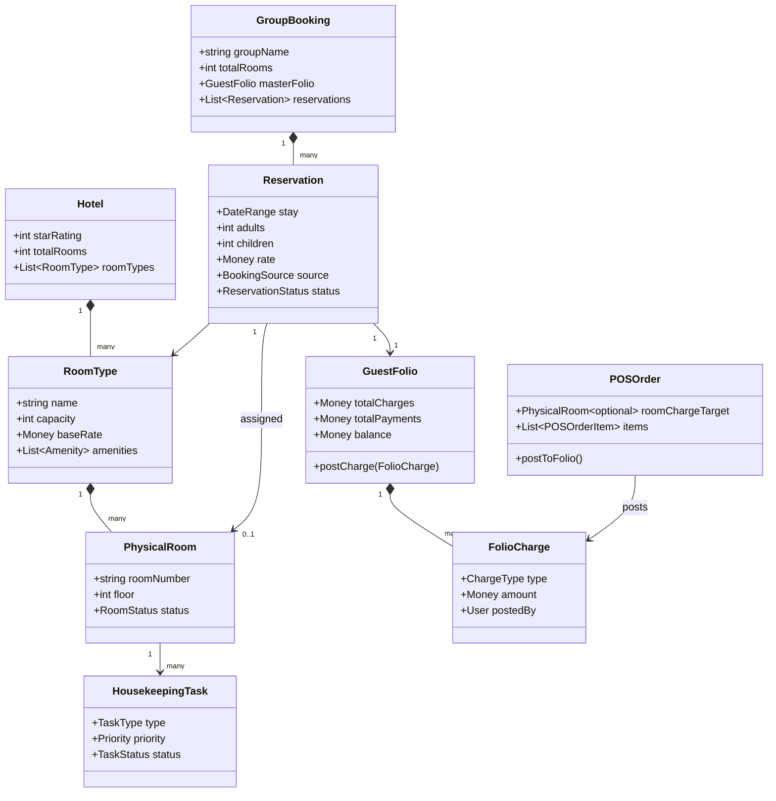
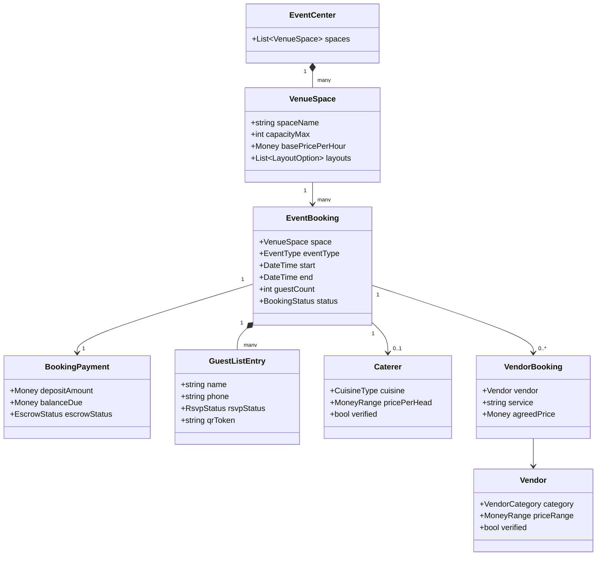
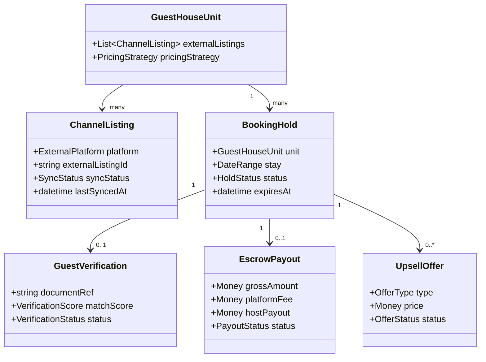

# Oaziland — Technical Architecture & Data Model

**Version 1.0 — Draft for Review**
**Prepared for:** Glorentech™ (Global Renaissance Technology SARL)

---

## 1. System Overview

Oaziland is a modular monolith at launch, structured so individual modules (Property, Social, Marketplace, Services, Payments) can be peeled off into microservices later without a rewrite. Mobile and web clients talk to one shared API layer, which talks to one shared database — no client owns its own copy of the data.



**Why a modular monolith first:** at your current stage, a well-bounded monolith with clean module interfaces ships faster, is cheaper to run, and is easier to debug than a distributed system — while still letting you extract, say, "Payments" or "Search" into its own service the day it needs independent scaling.

---

## 2. OOP Domain Model

The design favors **composition and roles over deep inheritance** — a real person can simultaneously be a Landlord, an Agent, and a Student, so "role" is modeled as attachable capability, not as a rigid class hierarchy.

### 2.1 Identity & Roles



A `User` is the single source of truth for authentication and identity. Each **role profile** is a separate table/object attached to the user — this is what lets one person hold multiple roles cleanly, and lets Admin grant/revoke a role without touching core identity data.

### 2.2 Property & Listings



Key design decision: **a `Listing` is separate from the `PropertyAsset`/`Unit` it describes.** The same physical property can have listing history (rented last year, for sale now) without losing its own identity — and a `Building` can have some units for rent and others for sale simultaneously, each with its own `Listing`.

### 2.2.1 Land Sub-Module — Trust & Verification Layer

Land is the highest-fraud-risk asset type in the Cameroonian market (disputed boundaries, fake or duplicate title deeds, absentee sellers), so `Land` gets a dedicated verification layer that other property types don't need. This extends `PropertyAsset` rather than replacing it:



**Behavior this layer enforces:**
- A `Land` listing **cannot publish** without a `titleDeedNumber` and `titleType`
- `documentBadge` only turns "verified" when an admin reviews the uploaded `SecureDocument` (title deed) — visible to buyers as a green badge, invisible-until-verified otherwise
- `siteVisitBadge` requires a timestamped, geo-tagged photo uploaded by staff/agent after a physical visit
- `ReservationDeposit` (via MTN MoMo / Orange Money) flips the listing to a time-boxed "Reserved" status — this reuses the shared `Payments` module, scoped to land
- `QuartierPriceTrend` is a computed rollup over closed/active `Land` listings per `Quarter` (from the geo hierarchy) — no separate data entry needed
- `LandInquiry` powers a reverse "Looking for Land" board — buyers post a search polygon + budget, matching sellers/agents get notified
- `distanceToTarmacKm` is computed from `GeoPoint` against road data (OpenStreetMap) at listing time, same pattern used for `nearbyFacilities`/`roadAccess` on the base `PropertyAsset`

This sub-module is intentionally **land-specific and additive** — houses, shops, and event centers don't inherit this trust machinery, since their fraud patterns and buyer expectations are different (though `VerificationBadge` and `ScamFlag` are generic enough to reuse elsewhere if you want site-visit verification on rentals later too).

### 2.3 Agent / Agency / Commission



Business rule captured directly in the model: `Transaction.representedBy` determines whether a `Commission` is generated at all. Direct landlord deals produce `Commission.amount = 0` unless a `paidToLandlord` arrangement is explicitly recorded.

### 2.4 Student Marketplace, Services, and Social — module summary

Rather than diagram every module, here's the entity summary for the remaining three:

**Student Module**
- `StudentProfile` (linked to `User`, holds `Institution`)
- `MarketplaceItem` (seller: StudentProfile, category, condition, price, media, status: available/sold)
- `Institution` (name, region — feeds student-specific content/discounts later)

**Technician / Facility Services Module**
- `TechnicianProfile` (specialties, coverage area, verification, rating)
- `ServiceCategory` (plumbing, electrical, cleaning, security install, etc.)
- `ServiceRequest` (requester, category, property/location, status, scheduledAt)
- `FacilityManagementContract` (property, technician/agency, recurring schedule, scope)
- `ProjectManagementCase` (larger jobs: renovations, new builds — milestones, budget, linked technicians)

**Social Layer**
- `Post` (author, media, caption, linked property optional)
- `Comment`, `Like`, `Reaction` (emoji type)
- `Follow` (follower, followee)
- `Review` / `Rating` (subject: User/Property/Agency, score, text)
- `Group` / `Community` (owner, members, posts)
- `Conversation` / `Message` (participants, text/media/audio, read receipts)

**Geography**
- `Country` → `Region` → `Division` → `Subdivision` → `Village/District` → `Quarter`, each a self-referencing or tiered table so any country's structure can be modeled, not just Cameroon's.

---

## 3. Relational Database Schema (Core Tables)



**Notes on the physical schema:**
- `PostgreSQL` as system of record; `PostGIS` extension for `GeoPoint`/`Address` columns to power radius search and map queries directly in SQL.
- `PROPERTY_ASSET` uses **single-table inheritance with a `type` discriminator column** (Land/House/Hotel/CommercialSpace/Shop/EventCenter/Building) rather than one table per subtype — simpler joins, and new property types are a migration, not a schema redesign.
- `MEDIA_ASSET` table stores pointers to object storage (S3-compatible), not files themselves — keeps the DB lean.
- All monetary columns store `(amount, currency_code)` pairs — never a bare number — since Oaziland will operate across multiple African currencies.
- Every table carries `created_at`, `updated_at`, and a soft-delete `deleted_at` for audit trail and admin recovery.

---

## 4. Module Breakdown (Codebase Structure)

```
oaziland/
├── identity/          # auth, roles, verification (KYC)
├── property/          # PropertyAsset, Building, Unit, Listing
├── land/                # Land trust layer: title verification, boundaries, reservations
├── hospitality/
│   ├── hotels/          # Hotel, RoomType, Reservation, Folio, POS, Housekeeping
│   ├── events/          # EventCenter, VenueSpace, EventBooking, Vendors, Catering
│   ├── student_hostels/ # StudentHostel, RoomAllocation, Semester, WelfareAlert
│   └── guest_houses/    # ChannelListing (OTA sync), BookingHold, GuestVerification, EscrowPayout
├── agency/            # AgencyProfile, AgentProfile, Commission
├── transactions/       # Transaction, escrow hooks, payments handoff
├── student/            # StudentProfile, MarketplaceItem
├── services/            # TechnicianProfile, ServiceRequest, FacilityMgmt, ProjectMgmt
├── social/              # Post, Comment, Follow, Group, Review, Messaging
├── geo/                 # Country/Region/.../Quarter, map & search integration
├── payments/            # Mobile Money, card rails, escrow, payouts
├── notifications/       # push, SMS, email, in-app
├── ai/                   # recommendation engine, fraud detection, chat assistant
├── blockchain/           # title-record anchoring, smart-contract escrow (optional phase)
├── admin/                # admin console backend — moderation, analytics, config
└── common/               # shared value objects: Money, Address, MediaAsset, AuditLog
```

Each module exposes a small internal API (service classes + interfaces) that other modules call — no module reaches directly into another's database tables. This is what keeps the "modular monolith → microservices later" path open.

---

## 5. Suggested Tech Stack

| Layer | Recommendation | Why |
|---|---|---|
| Backend | Django (Python) or NestJS (TypeScript) | Both give strong OOP structure, mature ORMs, fast to build admin tooling on |
| Web frontend | Next.js (React) | SSR for SEO, shared component logic with mobile via React Native |
| Mobile | React Native | Code/logic sharing with web team, fastest path to iOS + Android from one codebase |
| Database | PostgreSQL + PostGIS | Relational integrity for transactions/commissions, native geo support |
| Search | OpenSearch/Elasticsearch | Fast filtered property search at scale |
| Cache/session | Redis | Sessions, rate limiting, hot listing cache |
| Media storage | S3-compatible object storage + CDN | Images/video/audio at scale |
| Payments | Mobile Money aggregator (MTN/Orange APIs) + card processor | Matches Cameroon market reality |
| Messaging/chat | WebSocket service (or managed like Stream/Sendbird) | Real-time inbox, presence, read receipts |
| Blockchain | Permissioned ledger (e.g. Hyperledger) or public-chain anchoring | Title/contract integrity without full public-chain overhead |
| AI | Managed LLM API + a vector DB (pgvector or dedicated) | Recommendations, search relevance, support chat |

---

## 6. Security & Verification

- KYC-style identity verification (ID document + selfie match) before a user can list a property or operate as an agent/agency
- Role-based access control (RBAC) enforced at the API gateway, not just the UI
- Escrow-style payment holds for sale transactions until both parties confirm
- Full audit log on every listing, transaction, and commission event
- Rate limiting and fraud-scoring on listing creation and messaging to curb scam listings

---

## 7. Hospitality Modules — Event Centers, Hotels, Student Hostels

Glorentech's existing GRE-MOD-SPEC-002 specification (Event Centers, Hotels, Student Hostels) is absorbed into Oaziland as three specialized extensions of the property model, rather than bolted on as separate systems. Each reuses `PropertyAsset`, the shared Payments module, and the geo hierarchy already defined above — but each also needs operational entities that a simple listing doesn't (bookings, folios, housekeeping, room allocation).

### 7.1 Hotel Module



`Hotel extends PropertyAsset` the same way `Land` and `Building` do — it just carries far more operational state (front desk, folio, housekeeping) than a simple listing. Dynamic pricing (occupancy thresholds, weekend premiums, event-driven multipliers, length-of-stay discounts) lives as a pricing-strategy service reading `RatePlan` records, not hardcoded logic — keeping the pricing rules configurable per hotel.

### 7.2 Event Center Module



`BookingPayment` reuses the same escrow pattern as the `Transaction`/`Commission` model in §2.3 — deposit held until post-event completion is confirmed, balance settled at checkout. The Vendor Marketplace (`Caterer`, `Vendor`) is intentionally shared infrastructure: a photographer or DJ booked here is the same `Vendor` record a Hotel or Student Hostel event could book later.

### 7.3 Student Hostel Module — Integration with the Existing Student Module

This is where the fit with Oaziland's existing student module is closest: `StudentHostel` is a specialized `Building` (multi-unit, per §2.2) whose units are allocated to `StudentProfile` records already defined in §2.1 — not a new identity system.

- `StudentHostel extends Building`; its `Unit`s become `HostelRoom` (capacity, room type: single/double/triple/quad/postgrad/international)
- `RoomAllocation` links a `StudentProfile` to a `HostelRoom` for a given `Semester`, generated by a priority-weighted allocation service (accessibility needs → international status → programme/year grouping → gender matching → roommate preference → payment status)
- `Semester` billing cycles read from an institution's academic calendar (configurable per institution, not hardcoded to one university)
- `HostelBilling` / `HostelPayment` reuse the shared Payments module (MTN MoMo, Orange Money) with semester-based due dates instead of nightly rates
- `ParentGuardianAccess` is a consent-gated, read-only view onto a student's `HostelBilling` and welfare status — never onto `MaintenanceRequest`, disciplinary records, or guest logs
- `WelfareAlert` (payment distress, prolonged absence, safety risk, behavioural concern, medical incident, roommate conflict) is access-controlled and routed to hostel management and, where consented, the institution's student affairs contact
- `InstitutionIntegration` is an interface (not a hardcoded ICT University connector) so any partner institution can plug in admissions data, academic calendar, and scholarship records the same way

### 7.4 What This Adds to the Shared Model

- **Document Hub**: every module (Land, Hotel, Event Center, Student Hostel) generates contracts/receipts/reports through one shared `DocumentTemplate` + `GeneratedDocument` service, rather than each module implementing its own PDF generation
- **Commission/Revenue model extends per-module**: Hotel and Event Center bookings carry a platform commission percentage (distinct from the Agent/Agency commission in §2.3); Student Hostel carries a management-fee percentage on semester fees — both are just different `CommissionPolicy` configurations on the same underlying model
- **WhatsApp-first notification pattern** (from Terres.cm and GRE-MOD-SPEC-002 alike) becomes a shared `NotificationChannel` used across Land reservations, Hotel bookings, Event bookings, and Hostel payment reminders

---

## 8. Guest House & Short-Term Rental Module

This extends `Building`/`PropertyAsset` (short stays, high turnover) with the operational machinery a nightly-rental business needs — most of it shared with the Hotel module in §7.1 rather than duplicated.



**Key behaviors, mapped from the spec into things this architecture already has a place for:**
- `ChannelListing` syncs a unit's availability outward to external platforms (Airbnb, Booking.com) — this is new: an outbound integration layer, not present in the core model yet, and it's the one genuinely new infrastructure piece this module requires
- `BookingHold` reuses the same short-lived reservation-lock pattern already implied by `ReservationDeposit` in the Land module (§2.2.1) — a temporary hold with an expiry, not a new concept
- `GuestVerification` (ID + selfie match) is the same shape as the KYC verification already specified in §6 (Security & Verification) — applied per-stay instead of per-account
- `EscrowPayout` reuses the `Transaction`/`Commission` escrow pattern from §2.3 and §7.2 — gross amount minus platform fee, released on a trigger (here: check-in confirmation, not deal closure)
- `HousekeepingTicket` reuses `HousekeepingTask` from the Hotel module (§7.1) rather than a parallel system
- Host-facing ADR/RevPAR/occupancy reporting reuses the same Analytics/Admin dashboard infrastructure as Hotels, not a separate ERP console

The net effect: this "module" is mostly a thin **channel-sync + short-hold + escrow** layer sitting on top of infrastructure the rest of the architecture already defines. The channel manager (external OTA sync) is the only piece that's genuinely net-new — everything else here is reuse.

---

## 9. AI & Customer Service Layer

The AI-driven roadmap consolidates into the `ai/` and `notifications/` modules already in the folder structure (§4), organized by how much they change the data model vs. how much they're just services sitting on top of it.

**Services with no new core data model — read existing entities, act as a layer on top:**
- Conversational AI assistant (lead qualification, FAQ answering, hand-off to a human agent when confidence is low)
- AI recommendation feed / smart matchmaking (reads `Listing`, `User` interaction history)
- Instant valuation (AVM) — reads comparable `Listing`/`Transaction` history per quarter, same data `QuartierPriceTrend` (§2.2.1) already aggregates
- Visual search (photo-to-listing matching)
- Voice-driven search

**Services that need a small new entity:**
- `TourSchedule` — links a `User`, a `Listing`, and an agent's calendar slot; automated reminders reuse the shared `NotificationChannel` (§7.4)
- `VirtualTourAsset` — a 3D/AR media type attached to `PropertyAsset.media`, alongside photos/video, not a separate gallery system
- `SignableDocument` — extends the `GeneratedDocument` from the Document Hub (§7.4) with a signature workflow (signer, signed-at, signature hash)
- `UnifiedProfile` (CDP) — a read-optimized rollup of a `User`'s activity across every module (listings viewed, chats, bookings, `InteractionLog` entries) for agent context — not a new source of truth, just a materialized view
- `InteractionLog` — a free-text CRM entry recording a single interaction between staff and a client (who handled it, which listing/booking it concerned, timestamp, notes). This was the one genuinely missing piece against GRE-TECH-SPEC-001's data model: everywhere else logs *transactions* (a booking, a payment, a listing), but nothing captured the informal "client called about the Bastos apartment, wants a viewing next week" note an agent needs on file. `InteractionLog` attaches to a `User` (the client) and optionally to any `Listing`/`Booking`/`ServiceRequest` it concerned — one shared log across every module rather than a separate CRM system per module

**Deferred / speculative — not core-model work, evaluate later:**
- IoT smart-lock integration (hardware-dependent, needs a hardware partner first)
- Fractional property ownership (regulatory complexity — needs legal review before any data modeling)
- AR "street view" camera overlays

This keeps the "22-feature roadmap" from becoming 22 new subsystems — most of it is UI/service work over the domain model already defined in Sections 2–8, with only a handful of genuinely new entities.

---

## 10. Open Questions for Next Pass

- Confirm backend language preference (Django/Python vs. NestJS/TypeScript) — changes the codebase skeleton I'd generate next
- Confirm whether blockchain is a launch-phase requirement or a later phase (it's the most complex/expensive piece here)
- Confirm which Mobile Money providers to integrate first (MTN MoMo, Orange Money, both)
- Confirm launch priority among Land, Hotels, Event Centers, Student Hostels, and Guest House/STR — GRE-MOD-SPEC-002 recommends Student Hostels first (fastest institutional revenue via ICT University); worth deciding whether that sequencing carries over to Oaziland as a whole
- Confirm which AI features are launch-priority vs. deferred — the full 22-feature roadmap is too much for a first release; recommend starting with conversational assistant + AVM + recommendation feed and deferring IoT/fractional-ownership/AR overlays

