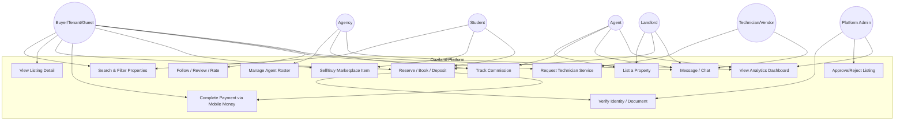
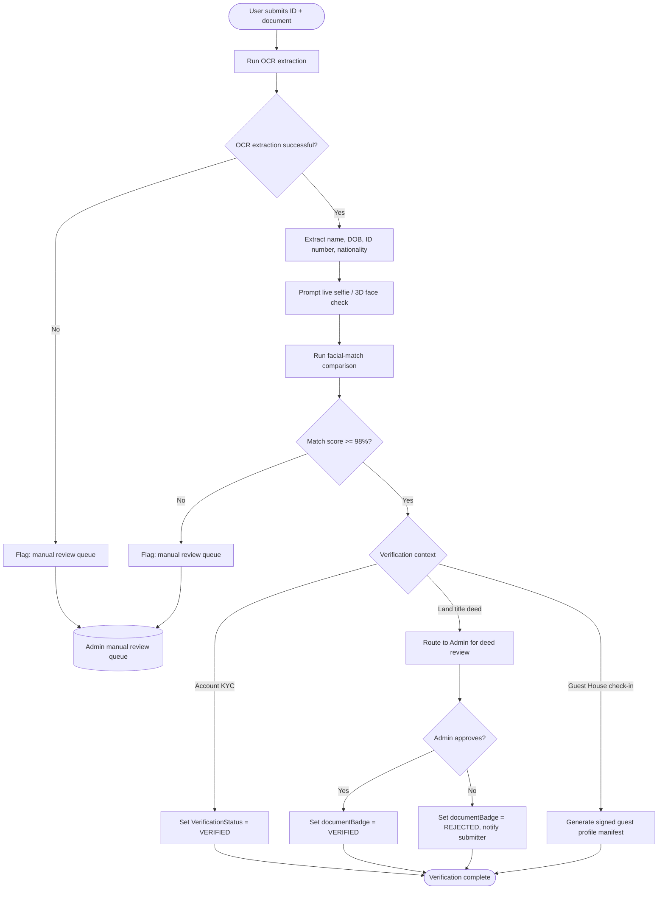
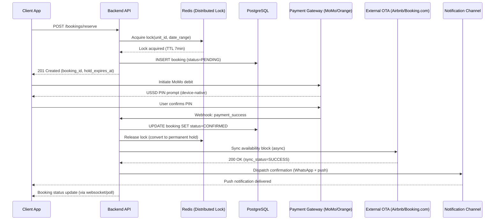
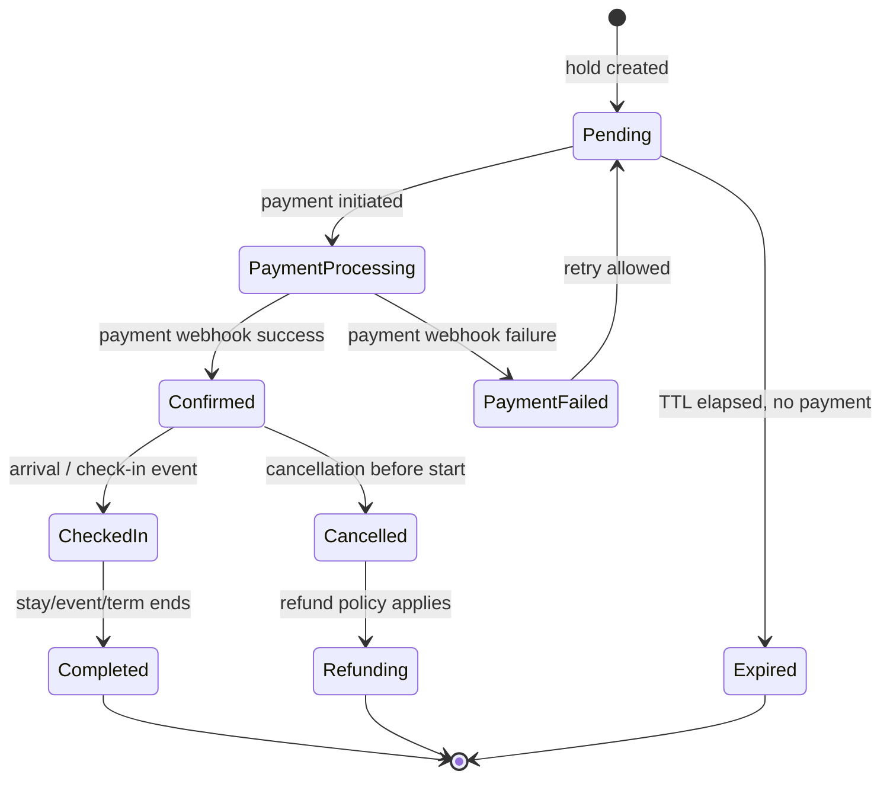

# Oaziland — Pre-Development Technical Design Package

**Companion to:** Oaziland Technical Architecture & Data Model (v1.0)
**Scope:** Full platform — mobile app + web app, shared backend and database

This document goes one level deeper than the architecture doc: concrete UML diagrams, physical database scripts, an API contract, an RBAC matrix, and UX flow checklists — the artifacts an engineering team builds directly from.

---

## 1. Use Case Specification

### 1.1 Actors

| Actor | Description |
|---|---|
| **Buyer/Tenant/Guest** | Searches, books, rents, buys, or reserves — the demand side across all property types |
| **Landlord/Owner** | Lists property directly, may or may not use an agent |
| **Agent** | Independent or agency-affiliated; lists on behalf of owners, earns commission |
| **Agency** | Manages a roster of agents, earns commission on their activity |
| **Student** | Special role: hostel resident, marketplace seller, campus-linked features |
| **Technician/Vendor** | Service provider (repairs, catering, photography, security, etc.) |
| **Platform Admin** | Moderates listings, verifies documents, manages disputes, views analytics |

### 1.2 Use Case Diagram



### 1.3 Detailed Use Case — "Reserve Property with Mobile Money Split-Escrow"

This is the representative core flow; Land deposits, Hotel bookings, Event Center bookings, Guest House stays, and Hostel semester billing are all variations of the same underlying pattern.

**Primary Actor:** Buyer/Tenant/Guest
**Preconditions:** User is authenticated; listing is published and available for the requested dates/terms
**Trigger:** User taps "Reserve" / "Book" / "Pay Deposit" on a listing

**Main Success Scenario:**
1. User selects listing, date range (or, for Land/Sale, confirms intent to reserve), and reviews the price breakdown.
2. System creates a `BookingHold` (or `ReservationDeposit` for Land) with `status = PENDING` and a short-lived TTL lock (default 7 minutes) against the specific unit/room/plot — inventory is now hidden from other searchers.
3. User selects Mobile Money provider (MTN MoMo or Orange Money) and confirms.
4. System sends a debit-authorization request to the payment aggregator; user receives a USSD PIN prompt on their device.
5. User enters PIN; aggregator returns a success webhook to the platform.
6. System verifies the webhook signature, moves `Booking.status = CONFIRMED`, releases the TTL lock permanently in the buyer's favor, and creates an `EscrowPayout` record with `status = HELD`.
7. System generates a `GeneratedDocument` (booking confirmation) and dispatches it via the shared `NotificationChannel` (WhatsApp + push + email).
8. If applicable, system notifies external channels (`ChannelListing` sync for Guest House) to block the same dates on Airbnb/Booking.com.
9. On completion trigger (check-in confirmed, event completed, deal closed at notaire, semester started) system computes `Commission` split and moves `EscrowPayout.status = RELEASED`, disbursing to landlord/agent/agency/vendor wallets.

**Extensions:**
- **3a. TTL expires before payment confirmation:** Hold is released automatically; inventory becomes searchable again; user is shown "This slot is no longer available" and returned to search.
- **5a. Payment webhook returns failure:** `Booking.status = PAYMENT_FAILED`; hold released; user prompted to retry with same or different provider.
- **5b. Webhook never arrives (timeout > TTL):** System treats as failure per 5a; any late-arriving webhook after release triggers an automatic refund flow.
- **6a. Race condition — two users attempt the same unit simultaneously:** Redis-backed distributed lock (Redlock algorithm) ensures only the first hold succeeds; the second user's hold request is rejected at step 2 with `409 Conflict`.
- **9a. Dispute raised before completion trigger:** `EscrowPayout` remains `HELD`; routed to Admin dispute-resolution queue; no automatic release until resolved.

**Error Fallback Protocols:**
- All payment-adjacent state transitions are idempotent (safe to retry / safe against duplicate webhooks) via a unique `idempotencyKey` on each transaction.
- Any external API failure (payment aggregator, OTA channel, WhatsApp) triggers exponential backoff retry (max 5 attempts), then falls back to logging a critical error and alerting Admin — the user-facing transaction is never left in an ambiguous state.

---

## 2. Activity Diagram — Identity & Document Verification

Shared across Land title-deed verification, KYC account verification, and Guest House pre-arrival biometric check-in — one verification engine, three trigger contexts.



**Logic gate detail:**
- OCR failure and match-score failure both route to the same manual review queue — no silent drops
- Land title deed verification always requires human admin sign-off even after passing automated OCR/match checks — the automated check only pre-screens, it never auto-approves a title deed
- Account KYC and Guest House check-in can auto-approve on a clean automated pass, since the stakes (account creation, hotel check-in) are lower than a land title claim

---

## 3. Sequence Diagram — Multi-Channel Booking Sync

Representative for any booking that must also block external calendars (Guest House/STR) or notify multiple parties (Hotel, Event Center).



---

## 4. State Machine Diagram — Booking Lifecycle

Single lifecycle model reused across Land reservations, Hotel reservations, Event bookings, Hostel allocations, and Guest House holds — each module only differs in what triggers the transitions.



---

## 5. Data Modeling Layers

### 5.1 Conceptual Model

Core business concepts and their relationships, in plain terms: a **User** can hold multiple **Roles**; a **PropertyAsset** (of any type) is owned by a User and located at an **Address** within the geo hierarchy; a **Listing** exposes a PropertyAsset or Unit for rent/sale; a **Booking** results from a user acting on a Listing; a **Transaction** and its **Commission** are generated when a Booking completes; every module-specific record (Reservation, EventBooking, RoomAllocation, BookingHold) is a specialization of the same underlying Booking concept. This maps directly onto the ERD in the architecture doc (§3) and the state machine above.

### 5.2 Logical Model — Core Cross-Cutting Tables

These are the tables shared across every module (Land, Hotel, Event Center, Student Hostel, Guest House) rather than module-specific tables already detailed in the architecture doc.

**`users`**
| Field | Type | Null | Key | Description |
|---|---|---|---|---|
| id | UUID | No | PK | |
| full_name | VARCHAR(200) | No | | |
| email | VARCHAR(200) | Yes | UNIQUE | |
| phone | VARCHAR(20) | No | UNIQUE | Primary contact — MTN/Orange number |
| password_hash | VARCHAR(255) | No | | |
| verification_status | ENUM | No | | UNVERIFIED / PENDING / VERIFIED / REJECTED |
| preferred_language | ENUM | No | | EN / FR |
| country_id | UUID | No | FK → countries | |
| created_at | TIMESTAMP | No | | |
| deleted_at | TIMESTAMP | Yes | | Soft delete |

**`bookings`** (generalized — see physical script in §5.3 for full detail)
| Field | Type | Null | Key | Description |
|---|---|---|---|---|
| id | UUID | No | PK | |
| booking_type | ENUM | No | | LAND_RESERVATION / HOTEL / EVENT / HOSTEL_SEMESTER / GUEST_HOUSE |
| target_id | UUID | No | | Polymorphic reference to Listing/Unit/VenueSpace/HostelRoom |
| requester_id | UUID | No | FK → users | |
| status | ENUM | No | | per state machine §4 |
| amount_xaf | DECIMAL(12,2) | No | | |
| currency | CHAR(3) | No | | Default XAF |
| hold_expires_at | TIMESTAMP | Yes | | Only set while status=PENDING |
| created_at | TIMESTAMP | No | | |

**`payment_escrow`**
| Field | Type | Null | Key | Description |
|---|---|---|---|---|
| id | UUID | No | PK | |
| booking_id | UUID | No | FK → bookings, UNIQUE | |
| gross_amount_xaf | DECIMAL(12,2) | No | | |
| platform_fee_xaf | DECIMAL(12,2) | No | | |
| payee_amount_xaf | DECIMAL(12,2) | No | | |
| status | ENUM | No | | HELD / RELEASED / REFUNDED / DISPUTED |
| provider | ENUM | No | | MTN_MOMO / ORANGE_MONEY / CARD |
| provider_reference | VARCHAR(100) | Yes | | External transaction ID |
| held_at | TIMESTAMP | No | | |
| released_at | TIMESTAMP | Yes | | |

**`interaction_log`**
| Field | Type | Null | Key | Description |
|---|---|---|---|---|
| id | UUID | No | PK | |
| client_id | UUID | No | FK → users | |
| staff_id | UUID | Yes | FK → users | NULL if system-generated |
| related_listing_id | UUID | Yes | | Polymorphic reference |
| related_booking_id | UUID | Yes | FK → bookings | |
| notes | TEXT | No | | Free-text |
| occurred_at | TIMESTAMP | No | | |

### 5.3 Physical PostgreSQL Model

```sql
-- BOOKINGS: the generalized booking record shared across all modules
CREATE TABLE bookings (
    id                UUID PRIMARY KEY DEFAULT gen_random_uuid(),
    booking_type      VARCHAR(30) NOT NULL
                        CHECK (booking_type IN (
                            'LAND_RESERVATION','HOTEL','EVENT',
                            'HOSTEL_SEMESTER','GUEST_HOUSE'
                        )),
    target_id         UUID NOT NULL,
    requester_id      UUID NOT NULL REFERENCES users(id) ON DELETE RESTRICT,
    status            VARCHAR(20) NOT NULL DEFAULT 'PENDING'
                        CHECK (status IN (
                            'PENDING','PAYMENT_PROCESSING','PAYMENT_FAILED',
                            'CONFIRMED','CHECKED_IN','COMPLETED',
                            'CANCELLED','REFUNDING','EXPIRED'
                        )),
    amount_xaf        DECIMAL(12,2) NOT NULL CHECK (amount_xaf >= 0),
    currency          CHAR(3) NOT NULL DEFAULT 'XAF',
    idempotency_key   VARCHAR(100) NOT NULL UNIQUE,
    hold_expires_at   TIMESTAMP NULL,
    created_at        TIMESTAMP NOT NULL DEFAULT now(),
    updated_at        TIMESTAMP NOT NULL DEFAULT now()
);

CREATE INDEX idx_bookings_target ON bookings (booking_type, target_id);
CREATE INDEX idx_bookings_requester ON bookings (requester_id);
CREATE INDEX idx_bookings_status_hold ON bookings (status, hold_expires_at)
    WHERE status = 'PENDING';  -- speeds up the TTL-expiry sweep job

-- PAYMENT_ESCROW: one-to-one with a booking
CREATE TABLE payment_escrow (
    id                  UUID PRIMARY KEY DEFAULT gen_random_uuid(),
    booking_id          UUID NOT NULL UNIQUE
                          REFERENCES bookings(id) ON DELETE CASCADE,
    gross_amount_xaf    DECIMAL(12,2) NOT NULL CHECK (gross_amount_xaf >= 0),
    platform_fee_xaf    DECIMAL(12,2) NOT NULL DEFAULT 0,
    payee_amount_xaf    DECIMAL(12,2) NOT NULL,
    status              VARCHAR(20) NOT NULL DEFAULT 'HELD'
                          CHECK (status IN ('HELD','RELEASED','REFUNDED','DISPUTED')),
    provider            VARCHAR(20) NOT NULL
                          CHECK (provider IN ('MTN_MOMO','ORANGE_MONEY','CARD')),
    provider_reference  VARCHAR(100),
    held_at             TIMESTAMP NOT NULL DEFAULT now(),
    released_at         TIMESTAMP NULL,

    CONSTRAINT chk_amount_split
        CHECK (payee_amount_xaf <= gross_amount_xaf)
);

CREATE INDEX idx_escrow_status ON payment_escrow (status)
    WHERE status IN ('HELD','DISPUTED');  -- fast lookup for reconciliation jobs
CREATE UNIQUE INDEX idx_escrow_provider_ref ON payment_escrow (provider, provider_reference)
    WHERE provider_reference IS NOT NULL;  -- prevents double-processing a webhook
```

---

## 6. API Contract — Booking Reservation Endpoint

```yaml
openapi: 3.0.3
info:
  title: Oaziland Booking API
  version: "1.0"
paths:
  /api/v1/bookings/reserve:
    post:
      summary: Create a reservation hold across any booking type (land, hotel, event, hostel, guest house)
      operationId: reserveBooking
      security:
        - bearerAuth: []
      requestBody:
        required: true
        content:
          application/json:
            schema:
              type: object
              required: [booking_type, target_id, amount_xaf, idempotency_key]
              properties:
                booking_type:
                  type: string
                  enum: [LAND_RESERVATION, HOTEL, EVENT, HOSTEL_SEMESTER, GUEST_HOUSE]
                target_id:
                  type: string
                  format: uuid
                  description: Listing, Unit, VenueSpace, or HostelRoom being reserved
                stay:
                  type: object
                  nullable: true
                  properties:
                    check_in:  { type: string, format: date-time }
                    check_out: { type: string, format: date-time }
                amount_xaf:
                  type: number
                  format: decimal
                payment:
                  type: object
                  required: [provider, phone_number]
                  properties:
                    provider:
                      type: string
                      enum: [MTN_MOMO, ORANGE_MONEY, CARD]
                    phone_number:
                      type: string
                idempotency_key:
                  type: string
                  description: Client-generated UUID to make retries safe
      responses:
        "201":
          description: Booking hold created
          content:
            application/json:
              schema:
                type: object
                properties:
                  booking_id: { type: string, format: uuid }
                  status: { type: string, example: PENDING }
                  hold_expires_at: { type: string, format: date-time }
        "400":
          description: Validation failure
          content:
            application/json:
              schema:
                type: object
                properties:
                  error_code: { type: string, example: VALIDATION_ERROR }
                  message: { type: string }
                  fields:
                    type: array
                    items:
                      type: object
                      properties:
                        field: { type: string }
                        reason: { type: string }
        "409":
          description: Inventory conflict — target already held or booked for the requested window
          content:
            application/json:
              schema:
                type: object
                properties:
                  error_code: { type: string, example: INVENTORY_CONFLICT }
                  message: { type: string, example: "This unit is no longer available for the selected dates." }
                  retry_suggested: { type: boolean, example: false }
```

---

## 7. RBAC Security Matrix

| Resource / Action | Buyer/Tenant | Landlord | Agent | Agency | Student | Technician | Admin |
|---|---|---|---|---|---|---|---|
| View published listings | ✅ | ✅ | ✅ | ✅ | ✅ | ✅ | ✅ |
| Create/edit own listing | ❌ | ✅ | ✅ | ✅ (via agents) | ❌ | ❌ | ✅ |
| Approve/reject listing verification | ❌ | ❌ | ❌ | ❌ | ❌ | ❌ | ✅ |
| Create booking/reservation | ✅ | ❌ | ❌ | ❌ | ✅ | ❌ | ❌ |
| View own booking history | ✅ | ✅ (own property) | ✅ (own deals) | ✅ (agency-wide) | ✅ | ✅ | ✅ (all) |
| Release/refund escrow | ❌ | ❌ | ❌ | ❌ | ❌ | ❌ | ✅ |
| Manage agent roster | ❌ | ❌ | ❌ | ✅ (own agency) | ❌ | ❌ | ✅ |
| View commission reports | ❌ | ❌ | ✅ (own) | ✅ (agency-wide) | ❌ | ❌ | ✅ (all) |
| Post marketplace item | ❌ | ❌ | ❌ | ❌ | ✅ | ❌ | ✅ (moderate) |
| Accept/manage service request | ❌ | ❌ | ❌ | ❌ | ❌ | ✅ | ✅ |
| View welfare alerts (hostel) | ❌ | ❌ | ❌ | ❌ | ❌ (own only) | ❌ | ✅ |
| Platform analytics dashboard | ❌ | ❌ | ✅ (own listings) | ✅ (agency) | ❌ | ❌ | ✅ (full) |
| Flag content / raise scam report | ✅ | ✅ | ✅ | ✅ | ✅ | ✅ | ✅ |
| Review flagged content | ❌ | ❌ | ❌ | ❌ | ❌ | ❌ | ✅ |

RBAC is enforced at the API gateway (per §6 of the architecture doc), not just hidden in the UI — every one of these checks is a server-side authorization rule, not a frontend conditional.

---

## 8. UX Flow Checklists

### 8.1 Search & Book (Buyer/Tenant/Guest)
- [ ] Landing screen: search bar + map toggle + category shortcuts (Land / Hotels / Events / Hostels / Guest Houses)
- [ ] Filter panel: price, location (Region→Quarter drill-down), property type, amenities
- [ ] Map view with pin clustering and draw-your-own-area tool
- [ ] Listing detail: gallery, price breakdown, verification badges, nearby facilities, reviews
- [ ] Reservation flow: date/unit selection → price confirm → Mobile Money checkout → confirmation screen
- [ ] Booking history / active reservations screen

### 8.2 List a Property (Landlord/Agent)
- [ ] Step-by-step listing wizard with save-and-continue
- [ ] Document upload zone (title deed / ownership proof) with private/admin-only flag
- [ ] Media upload (photos, video, drone embed)
- [ ] Pricing configuration (base rate, dynamic pricing toggle for Hotels/Guest Houses)
- [ ] Preview before publish
- [ ] Verification status tracker (Pending → Under Review → Verified/Rejected)

### 8.3 Agent/Agency Dashboard
- [ ] Active listings overview with status
- [ ] Roster management (Agency only): add/remove agents, view individual performance
- [ ] Commission tracker: pending, released, disputed
- [ ] Interaction log per client (CRM view)
- [ ] Booking calendar (Hotels/Event Centers)

### 8.4 Admin Console
- [ ] Verification queue (documents pending review)
- [ ] Listing moderation queue
- [ ] Scam/flag report queue
- [ ] Escrow dispute resolution panel
- [ ] Platform-wide analytics (revenue, active listings, occupancy, commission volume)
- [ ] Welfare alert queue (Student Hostel — access-controlled)

---

## 9. Pre-Development Readiness Tracker

| Design Category | Deliverable | Status |
|---|---|---|
| Operational Logic | Use Case, Activity, Sequence UML (this doc, §1–3) | Drafted |
| Code Blueprints | Class diagrams (architecture doc §2, §7–9) + state machine (this doc, §4) | Drafted |
| Data Infrastructure | Logical model + physical SQL (this doc, §5) | Drafted for core tables; module-specific tables in architecture doc §3 |
| Visual Interfaces | Figma high-fidelity UI + component library | Not started — needs design tooling, not text generation |
| Data Pipelines | OpenAPI spec (this doc, §6) | Drafted for one representative endpoint; full spec needs one entry per module |
| Hosting Blueprint | Cloud topology, microservice boundaries | Covered at a high level in architecture doc §1; detailed IaC not started |
| Business Controls | RBAC matrix (this doc, §7) | Drafted |
| UX Flows | Screen-by-screen checklists (this doc, §8) | Drafted at checklist level; clickable prototypes need a design tool |

**Honest gaps:** wireframes/mockups and clickable prototypes are a design-tool deliverable (Figma), not something text/markdown can substitute for — flagging rather than faking. Same for the full OpenAPI spec across every endpoint (dozens of routes) and complete infrastructure-as-code — both are mechanical extensions of the patterns established here, best done once the backend framework choice (Django vs. NestJS) is locked in.
